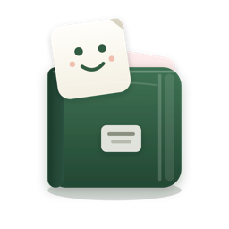

<p align="center"></p>
<h1 align="center">拾趣 · StickerNest</h1>
<p align="center">简体中文 · <a href="README_EN.md">English</a></p>
<p align="center">
  <a href="https://github.com/b1mango/StickerNest/releases/latest"></a>
  
  <a href="LICENSE"></a>
</p>

本地优先的 macOS 表情包管理器，收集、浏览和整理你的表情收藏。

## 功能

- 从微信、抖音或本地文件夹导入，按来源归档；拖入图片或文件夹即可导入。
- 选中后 ⌘C 复制或直接拖到微信聊天窗口，抖音的 webp 会自动转成微信可用的 GIF / PNG。
- 网格与列表两种视图，名称搜索、收藏、最近使用，空格快速查看。
- 用合集整理表情，支持批量重命名；右键或拖到侧栏合集即可归类。
- 扫描相似表情并选择保留项，误删内容可从回收站恢复。
- 导出选中原图，备份与恢复整个资料库；界面跟随系统浅色 / 深色。

## 安装使用

下载 [Apple Silicon 安装包](https://github.com/b1mango/StickerNest/releases/download/v0.0.2/StickerNest_0.0.2_aarch64.dmg)，打开 DMG，将 StickerNest 拖入「应用程序」。

首次启动选择「新建资料库」，或打开已有的 `StickerNest Library` 文件夹、从备份恢复；之后会自动打开上次使用的资料库。

## 开发

需要 Node.js 24.22.1、Rust 和 macOS Command Line Tools。桌面采集运行时还需 uv 已准备的可搬移 CPython 3.11 与 Pillow 13.0.0（`uv run --python 3.11 --with pillow==13.0.0 python -c "import PIL"`），或通过 `STICKERNEST_PYTHON` 指定同等环境。构建从本地准备并内置运行时，安装后的应用无需额外安装 Node.js/Python。

```sh
npm ci
npm run desktop
npm run desktop:build
```

React + TypeScript 构建界面，Tauri + Rust 处理本地文件、相似识别与备份；`src/` 为界面代码，`src-tauri/src/` 为原生逻辑。

## 许可证

[MIT](LICENSE) © b1mango
